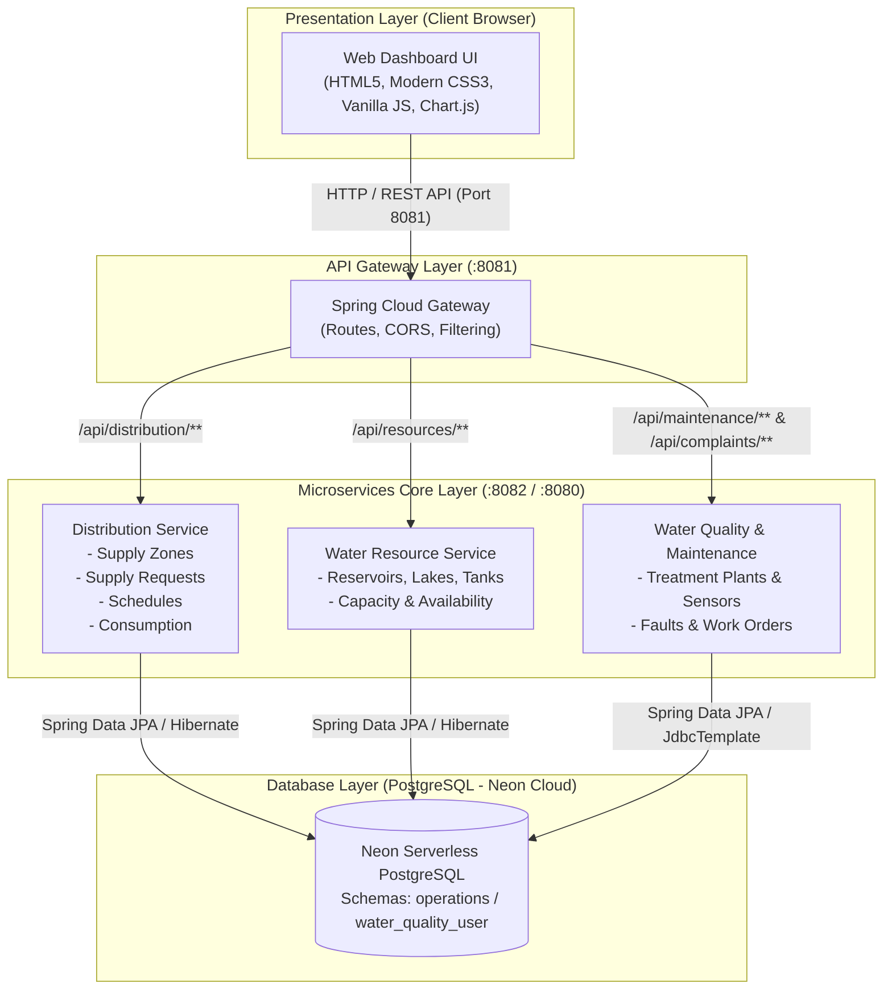

# SustainAI 2026 – GreenOps: Enterprise AI using Spring Boot & Microservices
**October 10 & 11, 2026**

---

# 1. Project Overview

### Project Title and Assigned Problem Statement
* **Project Title:** Integrated Water & Natural Resource Management
* **Problem Statement:** Modern urban and regional ecosystems suffer from fragmented, uncoordinated water management operations. Issues such as unmonitored extraction, undetected distribution leaks, lack of quota tracking, sudden water quality anomalies, and disconnected public grievance logging cause extensive environmental degradation and severe water wastage. The project addresses this by delivering a microservices-based, unified operations platform that automates resource monitoring, distribution scheduling, quality tracking, complaints handling, and infrastructure maintenance.

### Team Name, Members, and Institution
* **Team Name:** GreenOps Water Innovators (Team SustainAI-Water)
* **Institution / Organization:** SustainAI 2026 Hackathon
* **Team Members & Core Roles:**
  * **Joydeep Mandal** (`joydeepmandal26`) – *Team Lead, Architecture & Full-Stack Integration*
  * **Gokul / Gokshi** (`Gok24`) – *Distribution & Operations Microservice Engineer*
  * **Deepak** (`Deepak-205`) – *Water Resource Microservice & Validation Engineer*
  * **Nishant Sahani** (`Janxy15`) – *Water Quality Monitoring & Data Engine Specialist*
  * **Vikash** (`vikash-venus`) – *Frontend UI & Spring Cloud API Gateway Engineer*

### Problem Addressed and Proposed Solution
* **Problem Addressed:** Municipalities, industrial clusters, and regional bodies operate with siloed legacy tools. Raw water reservoirs operate without real-time correlation to zone quotas, consumption anomalies remain unaddressed until bills arrive, and public complaints are handled separately from infrastructure maintenance pipelines.
* **Proposed Solution:** An integrated enterprise cloud-ready architecture built on Spring Boot 3.x and Spring Cloud Gateway backed by cloud PostgreSQL (Neon). The platform synchronizes raw water capacity with downstream distribution quotas, logs real-time residential/commercial/industrial consumption, tracks treatment plant water quality, processes public complaints with auto-generated tracking identifiers, and facilitates maintenance work orders.

### Key Functionalities Implemented
1. **Water Resource Inventory & Live Capacity Tracking:** Monitoring lakes, reservoirs, wells, and tanks with physical metrics (total capacity, current level, inflow, outflow, and live availability calculation).
2. **Zone-Based Water Distribution & Request Management:** Management of municipal supply zones with assigned quotas, emergency request dispatching (`PENDING`, `APPROVED`, `REJECTED`, `FULFILLED`), and scheduled discharge planning.
3. **Multi-Category Consumption Accounting:** Granular tracking of water consumption by zone, consumer identifier, date, and user category (Residential, Commercial, Industrial).
4. **Water Quality & Treatment Plant Monitoring:** Real-time sensor telemetry generation and validation across facilities (pH, Turbidity, Dissolved Oxygen, Temperature, and Chlorine levels).
5. **Citizen Complaints & Grievance Redressal:** Public portal to lodge leakages, contamination, or pressure drops with deterministic tracking numbers (`CMP-YYYYMMDD-XXXX`) and status lifecycles.
6. **Infrastructure Asset & Maintenance Scheduling:** Tracking treatment plants, pumps, and pipelines with predictive and reactive work-order logging, severity levels, and technician dispatching.
7. **Unified Microservices API Gateway:** Centralized routing, rate limiting, and CORS handling via Spring Cloud Gateway on port `8081`.

---

# 2. System Architecture & Technologies

### Overall Architecture Diagram



### Microservices and Their Responsibilities

| Microservice | Default Port | Primary Responsibilities |
| :--- | :--- | :--- |
| **Spring Cloud API Gateway** | `8081` | Central entry-point for all frontend HTTP requests. Handles request routing to backend services, path rewriting, unified error fallbacks, and cross-origin (CORS) enforcement. |
| **Distribution Service** (`distribution-service`) | `8082` | Manages supply zone quotas, processes ad-hoc and emergency water requests, schedules automated valve discharges, and aggregates daily zone consumption. |
| **Water Resource Service** (`water-resource-service`) | `8082` / Internal | Tracks physical surface and ground water assets (lakes, reservoirs, borewells), enforces level boundary validation (`currentLevel <= capacity`), and computes available headroom. |
| **Water Quality & Operations Service** (`quality_maintainance`) | `8082` / Internal | Manages treatment facility metrics, equipment reliability records (pumps, pipes), fault logging, inspection records, and public grievance tickets. |

### REST API Communication Between Services
* **Frontend-to-Gateway Communication:** JSON-based RESTful HTTP transactions communicating through the reverse proxy on port `8081`.
* **Inter-Service Communication:** Designed for direct asynchronous HTTP / REST exchange where the Distribution Service validates available capacity against the Water Resource Service (`/api/resources/{id}/availability`) prior to transitioning request states to `APPROVED`.
* **Uniform Response & Status Codes:** Uses standard HTTP semantics (`200 OK`, `201 Created`, `204 No Content`, `400 Bad Request`, `404 Not Found`, and `503 Service Unavailable`).

### Technology Stack
* **Backend:** Java 21, Spring Boot 3.2.0, Spring Cloud Gateway 2023.x
* **Data Access & ORM:** Spring Data JPA, Hibernate ORM, Spring `JdbcTemplate`
* **Database:** PostgreSQL 16 (Hosted on Neon Serverless Cloud with SSL mode required)
* **Frontend:** Semantic HTML5, Responsive Flexbox/Grid CSS3, Vanilla JavaScript (ES6+), Chart.js (Data Visualizations), FontAwesome Icons
* **Build & Dependency Management:** Apache Maven 3.9+ (`mvnw`)
* **Utilities & Validation:** Project Lombok, Jakarta Validation (`jakarta.validation-api`)

---

# 3. Implementation

### Brief Description of the Major Functionalities Implemented
1. **Supply Zone Quota & Allocation Engine:** Allows municipal operators to provision geographic zones, define maximum daily quota limits in liters, and monitor real-time consumption against threshold constraints.
2. **Water Demand & Request Dispatching:** Operators can submit regular or emergency water dispatch requests specifying required volume, urgency level, and justification. Status changes trigger record updates in the persistence store.
3. **Hydrological Inventory Validation:** Strict bean validation (`@NotNull`, `@Min(0)`, `@AssertTrue`) ensures data integrity—preventing physical impossibilities such as negative water volume or current levels exceeding maximum structural capacity.
4. **Maintenance & Complaint Ticket Lifecycle:** Citizen reports are converted into tracked issues; facility managers can record component breakdowns (pumps, pipes) and schedule preventative or corrective work orders.
5. **Local Persistence Fallback (Demo Engine):** Implemented client-side storage persistence (`localStorage` synchronization) inside `api.js` to ensure uninterrupted offline/demo evaluation even during cloud network partitions.

### Database Design & Major Tables / Entities

#### Entity: `SupplyZone` (`operations.supply_zones`)
* `id` (`BIGINT`, PK, Auto-Increment)
* `zone_code` (`VARCHAR`, Unique, Not Null) – e.g., "NZ-01"
* `zone_name` (`VARCHAR`) – e.g., "North Industrial Sector"
* `daily_allocated_quota_liters` (`DOUBLE PRECISION`)
* `current_allocation_liters` (`DOUBLE PRECISION`)
* `status` (`VARCHAR`) – `ACTIVE`, `RESTRICTED`, `CRITICAL`

#### Entity: `SupplyRequest` (`operations.supply_requests`)
* `id` (`BIGINT`, PK, Auto-Increment)
* `zone_id` (`BIGINT`, FK to `supply_zones`)
* `requested_by` (`VARCHAR`)
* `requested_quantity_liters` (`DOUBLE PRECISION`)
* `urgency` (`VARCHAR`) – `LOW`, `MEDIUM`, `HIGH`, `EMERGENCY`
* `reason` (`TEXT`)
* `status` (`VARCHAR`) – `PENDING`, `APPROVED`, `REJECTED`, `FULFILLED`
* `request_timestamp` (`TIMESTAMP`)

#### Entity: `DistributionSchedule` (`operations.distribution_schedules`)
* `id` (`BIGINT`, PK, Auto-Increment)
* `zone_id` (`BIGINT`)
* `start_time` (`TIMESTAMP`)
* `end_time` (`TIMESTAMP`)
* `target_discharge_liters` (`DOUBLE PRECISION`)
* `status` (`VARCHAR`) – `SCHEDULED`, `IN_PROGRESS`, `COMPLETED`, `CANCELLED`

#### Entity: `WaterConsumption` (`operations.water_consumptions`)
* `id` (`BIGINT`, PK, Auto-Increment)
* `zone_id` (`BIGINT`)
* `category` (`VARCHAR`, Not Null) – `RESIDENTIAL`, `COMMERCIAL`, `INDUSTRIAL`
* `consumption_liters` (`DOUBLE PRECISION`)
* `record_date` (`DATE`)
* `consumer_identifier` (`VARCHAR`)

#### Entity: `WaterResource` (`operations.water_resources`)
* `id` (`BIGINT`, PK, Auto-Increment)
* `name` (`VARCHAR`, Not Null)
* `type` (`VARCHAR`, Enum: `RESERVOIR`, `LAKE`, `WELL`, `TANK`, `WATER_SOURCE`)
* `location` (`VARCHAR`, Not Null)
* `capacity` (`DOUBLE PRECISION`, Not Null, $\ge 0$)
* `current_level` (`DOUBLE PRECISION`, Not Null, $\le \text{capacity}$)
* `inflow` (`DOUBLE PRECISION`, Not Null, $\ge 0$)
* `outflow` (`DOUBLE PRECISION`, Not Null, $\ge 0$)

### One End-to-End Workflow Explaining How the Application Operates
**Workflow: Municipal Emergency Water Request & Allocation Lifecycle**
1. **Request Submission:** A municipal ward representative opens the portal and submits an emergency supply request of $250,000\text{ L}$ for *North Zone (Zone 1)* due to pipeline repair in an adjacent sector.
2. **Ingestion & Ingress Routing:** The browser transmits a `POST` request with JSON payload to `http://localhost:8081/api/distribution/requests`. The Spring Cloud Gateway validates routes and forwards the payload to `distribution-service` running on port `8082`.
3. **Entity Persistence & Validation:** The `DistributionController` assigns the request an automated timestamp (`LocalDateTime.now()`) and sets its initial status to `PENDING`. It persists the record to the `operations.supply_requests` table on the PostgreSQL database.
4. **Capacity Audit:** An operator inspects the Water Resource inventory (`/api/resources/1/availability`) to verify whether *Reservoir A* has sufficient available discharge volume without breaching baseline safety reserves.
5. **Approval & Schedule Generation:** The operator issues a status update via `PATCH /api/distribution/requests/1/status?status=APPROVED`. Concurrently, a dispatch schedule is generated (`POST /api/distribution/schedules`) with designated valve open and close windows.
6. **Consumer Logging & Visualization:** Flow meters record discharge, and consumption records are posted to `/api/distribution/consumption`. The frontend Dashboard retrieves the new statistics and updates the Chart.js telemetry charts.

---

# 4. Demonstration & Testing

### Application Screens & Layout Breakdown
1. **Executive Dashboard (`index.html`):** Displays top-level KPI cards (Total Active Resources, Current Stored Volume, Today's Gross Consumption, Open Grievances) with interactive Chart.js line charts illustrating consumption trends and resource fill percentages.
2. **Water Resources Management (`resources.html`):** Table of active reservoirs and lakes displaying live water levels, capacity meters, inflow/outflow balance, and a modal form to add or edit resources with real-time level validation.
3. **Consumption & Distribution (`consumption.html`):** Zone-by-zone breakdown showing quota usage, category splits (Residential vs Commercial vs Industrial), and an interactive form to log new distribution schedules.
4. **Water Quality & Tracking (`tracking.html`):** Monitors telemetry from treatment plants, highlighting out-of-spec chemical parameters (turbidity spikes, pH deviation) and physical asset conditions.
5. **Citizen Grievance Redressal (`complaints.html`):** Public complaint filing interface with automated tracking number generation (`CMP-...`), category filtering, and status progression.
6. **Maintenance & Asset Operations (`maintenance.html`):** Work order management interface tracking maintenance schedules, affected infrastructure (Pumps, Pipes), severity badges, and resolution logging.

### Sample Inputs and Outputs

#### Sample 1: Creating a New Water Resource
* **Request:** `POST /api/resources`
  ```json
  {
    "name": "Victoria Lake Reservoir",
    "type": "RESERVOIR",
    "location": "Sector 4B North Basin",
    "capacity": 5000000.0,
    "currentLevel": 3850000.0,
    "inflow": 45000.0,
    "outflow": 32000.0
  }
  ```
* **Response:** `200 OK`
  ```json
  {
    "id": 12,
    "name": "Victoria Lake Reservoir",
    "type": "RESERVOIR",
    "location": "Sector 4B North Basin",
    "capacity": 5000000.0,
    "currentLevel": 3850000.0,
    "inflow": 45000.0,
    "outflow": 32000.0
  }
  ```

#### Sample 2: Submitting an Emergency Water Supply Request
* **Request:** `POST /api/distribution/requests`
  ```json
  {
    "zoneId": 3,
    "requestedBy": "Ward 9 Relief Officer",
    "requestedQuantityLiters": 120000.0,
    "urgency": "EMERGENCY",
    "reason": "Main feeder rupture in residential sector"
  }
  ```
* **Response:** `200 OK`
  ```json
  {
    "id": 48,
    "zoneId": 3,
    "requestedBy": "Ward 9 Relief Officer",
    "requestedQuantityLiters": 120000.0,
    "urgency": "EMERGENCY",
    "reason": "Main feeder rupture in residential sector",
    "status": "PENDING",
    "requestTimestamp": "2026-10-11T09:42:15.284"
  }
  ```

### Brief Details of Testing Performed and Results
* **Test Plan Implementation:** Documented under `testing_docs/` covering unit testing (`JUnit 5`, `Mockito`), database integration testing against Neon PostgreSQL, and UI integration.
* **REST API Endpoint Testing:** Verified valid JSON schema ingestion, HTTP error response generation for negative test cases (such as requesting non-existent resource IDs returning `404 Not Found`).
* **Database Constraint Verification:** Validated schema constraints across `operations.supply_zones`, ensuring `zone_code` uniqueness and rejection of negative capacity attributes.
* **UI & Client-Side Verification:** Confirmed responsive viewports, Chart.js dataset updates upon adding resources, and `localStorage` state preservation across page reloads.

### Incomplete Features & Known Limitations
1. **Lombok Annotation Preprocessing:** In certain compiler environments without the Lombok annotation processor enabled during `mvn compile`, getter/setter bindings on `SupplyRequest` require explicit manual getter generation.
2. **Cross-Service Distributed Transactions:** The automated verification between `distribution-service` and `water-resource-service` relies on sequential HTTP calls rather than an event-driven message broker (e.g., Kafka / RabbitMQ).
3. **Role-Based Access Control (RBAC):** Authentication and token verification (Spring Security / OAuth2) are currently bypassed in the demo configuration to permit open judge testing.

---

# 5. GitHub Repository & Team Contributions

### GitHub Repository URL
* **Repository:** `https://github.com/joydeepmandal26/Integrated-Water-Natural-Resource-Management.git`
* **Active Branches:** `main`, `quality_maintainance`, `water-operations`, `water-resource`, `water-resource-db1`, `testing_docs`, `frontend-vikash-upload`

### Brief Instructions to Configure and Run the Application

#### Prerequisites
* Java Development Kit (JDK) 21 installed and on `PATH`
* Apache Maven 3.8+ (or use the included `./mvnw` wrapper)
* Active internet connection for Neon PostgreSQL cloud database access

#### 1. Database Configuration
Database connection parameters are pre-configured in `src/main/resources/application.properties` pointing to Neon Cloud PostgreSQL:
```properties
spring.datasource.url=jdbc:postgresql://ep-steep-sunset-b5qur8pl-pooler.c-7.us-east-2.aws.neon.tech/neondb?sslmode=require&channel_binding=require
spring.datasource.username=water_operations_user
spring.datasource.password=Water_operations@123
spring.jpa.hibernate.ddl-auto=update
```

#### 2. Building & Running the Core Backend Services
Open a terminal in the root directory and start the Spring Boot application:
```bash
cd Integrated-Water-Natural-Resource-Management
./mvnw clean spring-boot:run
```
*The service starts on port `8082` (or `8080`).*

#### 3. Running the Spring Cloud Gateway
In a separate terminal, start the gateway service:
```bash
cd Integrated-Water-Natural-Resource-Management/gateway
mvn clean spring-boot:run
```
*The Gateway proxy starts on port `8081`.*

#### 4. Accessing the Web Frontend
* Directly access via browser: `http://localhost:8080/index.html` (served statically from Spring Boot resources) or open `frontend/index.html` in any web browser.
* To switch from offline demo data to live gateway endpoints, toggle `DEMO_MODE: false` in `src/main/resources/static/js/config.js`.

### Contributions of Each Team Member
* **Joydeep Mandal (`joydeepmandal26`):**
  * Overall project structure and repository integration.
  * Configured build plugins (`pom.xml`), Spring Boot static resource mapping (`WebConfig`), and cloud database schema integration.
  * Built client-side `localStorage` state synchronization and dynamic consumption calculation logic.
* **Gokul / Gokshi (`Gok24`):**
  * Implemented the `distribution-service` entity layer (`SupplyZone`, `SupplyRequest`, `DistributionSchedule`, `WaterConsumption`).
  * Created JPA repositories and `DistributionController` endpoints for managing supply quotas, requests, and schedules.
* **Deepak (`Deepak-205`):**
  * Implemented the `water-resource-service` subsystem.
  * Authored `WaterResource` entity with strict validation rules (`ResourceType`, `@Min(0)` constraints, and available headroom logic).
  * Designed `WaterResourceController` and service layer for physical asset management.
* **Nishant Sahani (`Janxy15`):**
  * Developed the `waterquality` module and telemetry generator (`WaterQualityDataGenerator`).
  * Structured JDBC templates for treatment plants, pump/pipeline infrastructure, inspections, and fault logging.
* **Vikash (`vikash-venus`):**
  * Designed and authored all responsive frontend views (`index.html`, `resources.html`, `consumption.html`, `tracking.html`, `complaints.html`, `maintenance.html`).
  * Configured Spring Cloud API Gateway routes (`application.yml`) to proxy traffic between frontend and microservices.

### External APIs, Datasets, Libraries, or References Used
* **Neon PostgreSQL:** Serverless cloud PostgreSQL database hosting operational schemas.
* **Spring Boot Starter JPA & Hibernate:** ORM persistence layer.
* **Spring Cloud Gateway:** Reactive reverse proxy routing and traffic orchestration.
* **Chart.js (v4.x):** Responsive canvas rendering of telemetry and trend charts.
* **FontAwesome (v6.x):** Visual iconography for UI cards, status badges, and navigation.

### Future Enhancements
1. **Event-Driven Messaging via Apache Kafka:** Decouple quota depletion alerts and inter-service validation via asynchronous event topics.
2. **IoT Sensor Ingestion Pipeline:** Integrate MQTT/CoAP broker connectors for direct edge hardware ingestion from physical water meters and water treatment telemetry probes.
3. **GIS & Geospatial Mapping:** Integrate Leaflet.js / OpenStreetMap to render pipe networks, valves, and geographic heatmaps of distribution loss and contamination reports.
4. **Role-Based OAuth2 Authentication:** Integrate Keycloak or Spring Security with JWT tokens to enforce distinct roles (Citizen, Field Technician, Municipal Operations Director).

